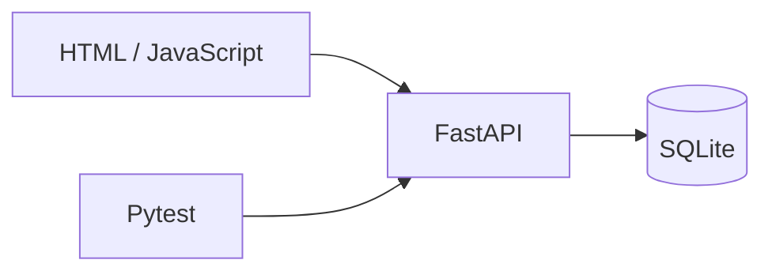

# CaseFlow | Enterprise Case Management

Prototipo personal de gestión de casos empresariales. Utiliza exclusivamente datos ficticios. No contiene código, datos ni reglas internas de ninguna institución.

## Funcionalidades
- Registro de casos, responsables y prioridad.
- Actualización de estados y tablero de indicadores.
- API REST documentada mediante OpenAPI.
- Persistencia SQLite y validación de entradas.

## Arquitectura


## Instalación local
Requiere Python 3.12.
```bash
python -m venv .venv
# Windows: .venv\\Scripts\\activate
# Linux/macOS: source .venv/bin/activate
pip install -r requirements-dev.txt
python -m uvicorn app:app --reload
```
Abrir http://localhost:8000 y consultar Swagger en http://localhost:8000/docs.

## Pruebas
```bash
python -m pytest -q
```

## Docker
```bash
docker build -t caseflow .
docker run --rm -p 127.0.0.1:8000:8000 caseflow
```
La base del contenedor es temporal; para conservarla, montar un volumen y definir CASEFLOW_DB con una ruta dentro de ese volumen.

## API
| Método | Ruta | Operación |
|---|---|---|
| GET | /health | Estado del servicio |
| GET | /api/cases | Listado |
| POST | /api/cases | Creación |
| PATCH | /api/cases/{id} | Cambio de estado |

## Alcance y próximos pasos
Versión 0.1: demostración local sin autenticación. No desplegar públicamente sin controles de acceso. Pendientes: autenticación, roles, auditoría, PostgreSQL, migraciones, automatización de recordatorios y despliegue seguro. El código de pruebas está incluido; verificar su ejecución antes de considerar la versión validada.
