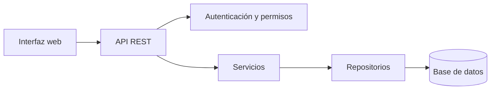
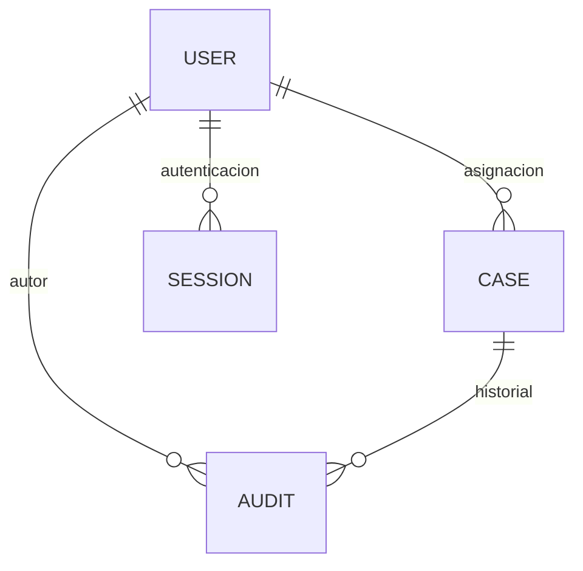

# Arquitectura de CaseFlow

La aplicación separa la interfaz, las rutas HTTP, las reglas del negocio y el acceso a la base de datos. De esta manera, un cambio en la presentación no requiere modificar directamente las consultas SQL.

## Modelo de datos

Los nombres de las entidades coinciden con los identificadores técnicos del código. Cada caso tiene un responsable y una versión que aumenta cuando cambia el estado. El registro de auditoría conserva el autor y la descripción de la operación.

## Reglas de operación

- Un analista solo puede consultar y modificar sus casos.
- Los cambios válidos son Abierto → En proceso → Resuelto, con posibilidad de volver de En proceso a Abierto y de Resuelto a En proceso.
- Si la versión enviada no coincide con la almacenada, la API devuelve HTTP 409.

## Seguridad y persistencia

Las contraseñas se almacenan con PBKDF2 y una sal individual. Los tokens de sesión son aleatorios, se guardan mediante hash y caducan a las ocho horas. En la interfaz permanecen en memoria, no en localStorage. SQLAlchemy permite trabajar con SQLite o configurar PostgreSQL.

La base se inicializa al arrancar. Esta decisión facilita las pruebas locales; para una instalación de producción faltan migraciones con Alembic, HTTPS, limitación de intentos, gestión de secretos y una revisión de los controles de acceso.
