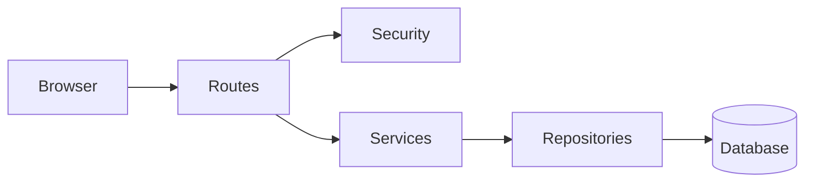
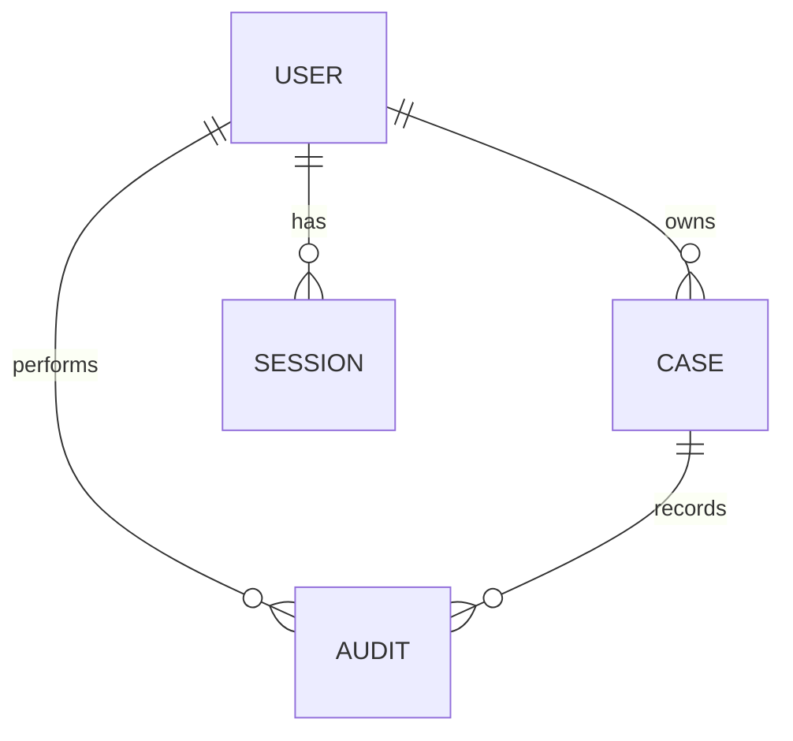

# Architecture
Frontend calls an authenticated REST API. Routes validate requests; services enforce role and state transitions; repositories encapsulate filtered reads, optimistic concurrency and auditing. SQLAlchemy maps the relational model to SQLite for local use or PostgreSQL with Compose.

Security: PBKDF2 salted password hashes, expiring opaque bearer tokens stored hashed, scoped analyst queries, optimistic versions. No hard-coded accounts. Tokens stay in browser memory. No public deployment, rate limiting, TLS, migrations or attachments yet. The demo database schema is intentionally created on startup; production requires Alembic migrations, secret management and operational controls.
